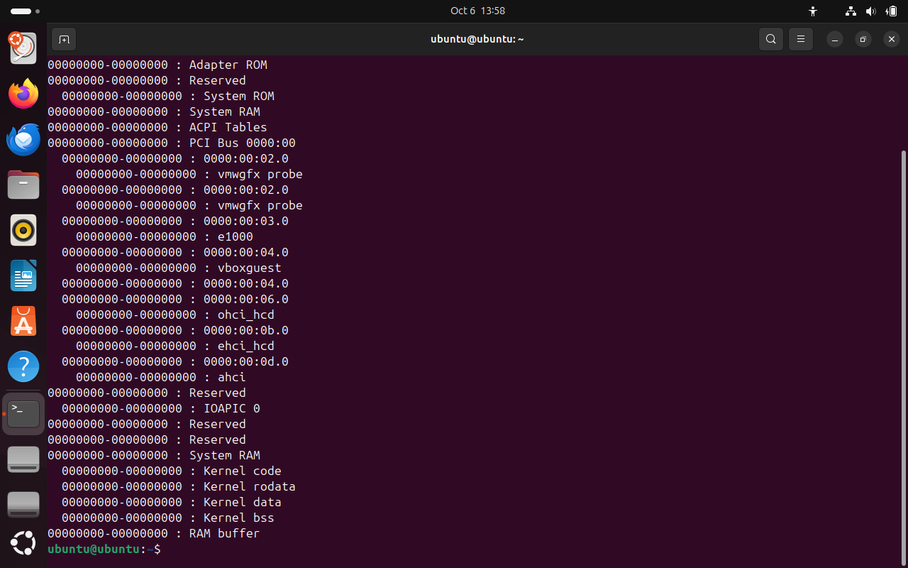
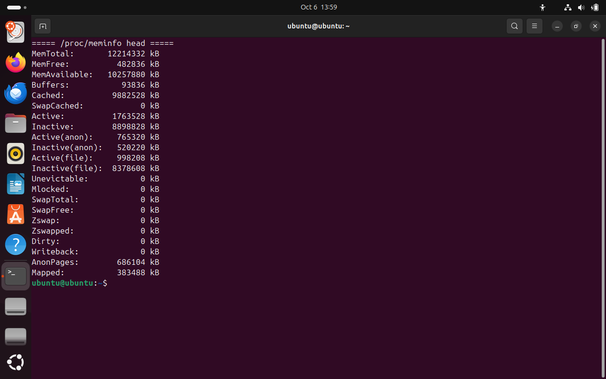
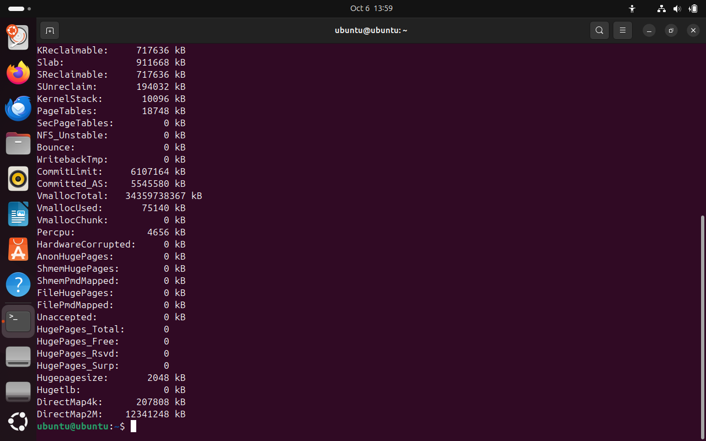
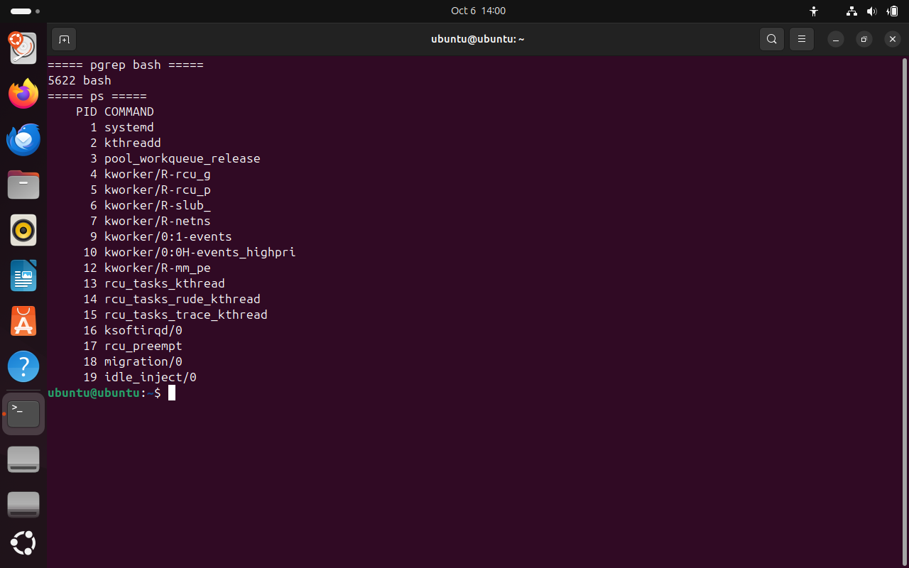
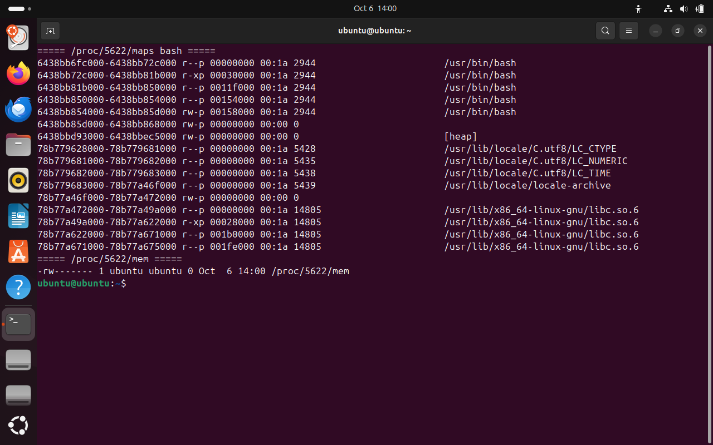
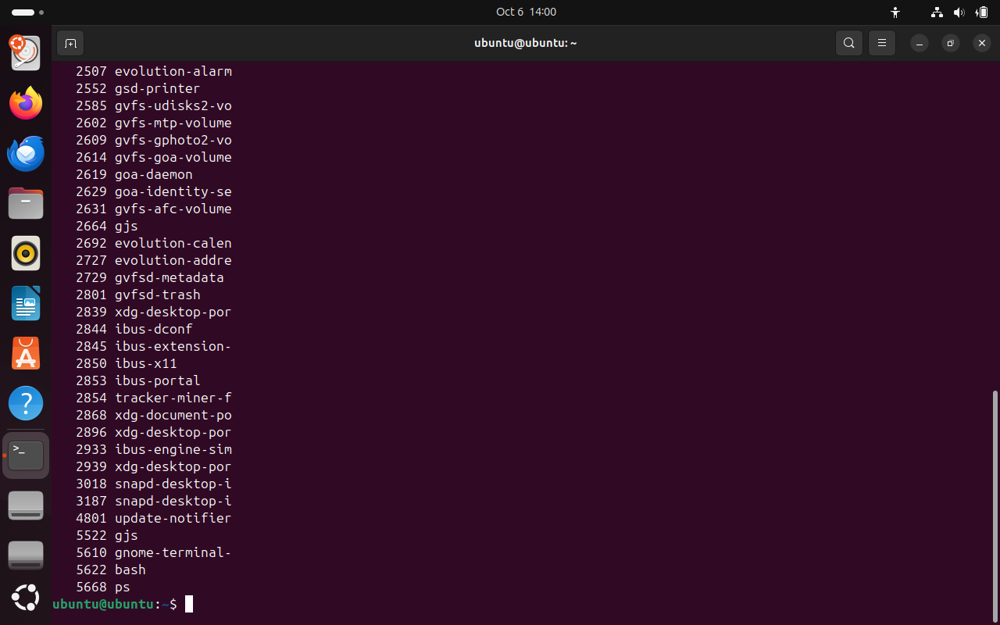
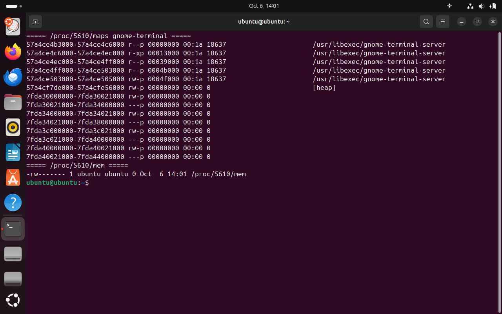
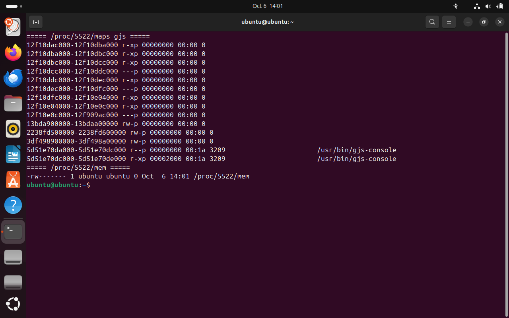
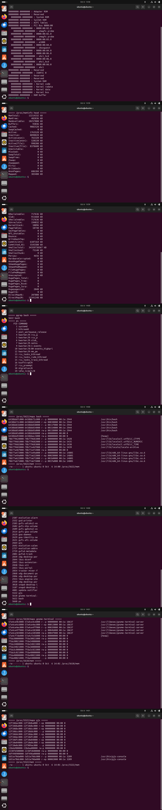

# Память процесса

Скрины лежат в `screenshots`. Ниже к каждому кадру сказано, какая команда на нем и что по ней видно.

Карта физической памяти. `cat /proc/iomem` показывает, какие диапазоны адресов заняты устройствами и системной памятью.

Начало `/proc/meminfo`: общий объем, свободная память и доступная память.

Полный `/proc/meminfo`: buffers, cached, swap и остальные счетчики ядра.

`pgrep` находит PID процессов по имени, чтобы дальше смотреть их память, а не весь список системы.

Карта памяти bash: `cat /proc/<pid>/maps`. Видно, какие участки адресного пространства заняты кодом, кучей и библиотеками.

`ps` от обычного пользователя: свои процессы и сколько памяти они занимают.

Память процесса `gnome-terminal`. Терминал, из которого снимались команды, тоже виден в списке.

Память `gjs`, процесса графической оболочки. Он отдельно от терминала и от bash.

Общий лист всех кадров этой работы на одном изображении.

