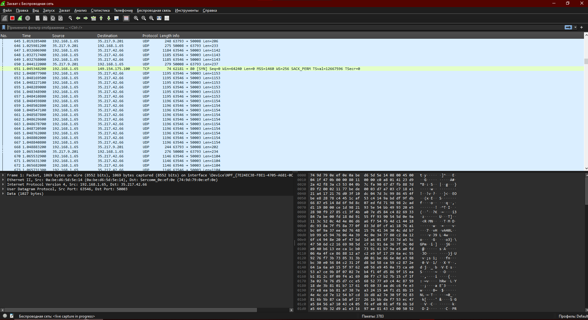

# Захват трафика

Скрин лежит в `screenshots`.

На кадре открыт Wireshark, интерфейс беспроводной сети, захват уже идет. В списке пакетов в основном UDP между адресами локальной сети `192.168.1.65` и `35.217.9.201`, порты в диапазоне 50000. Выделен один UDP-кадр, снизу открыты его заголовки и шестнадцатеричный дамп.

